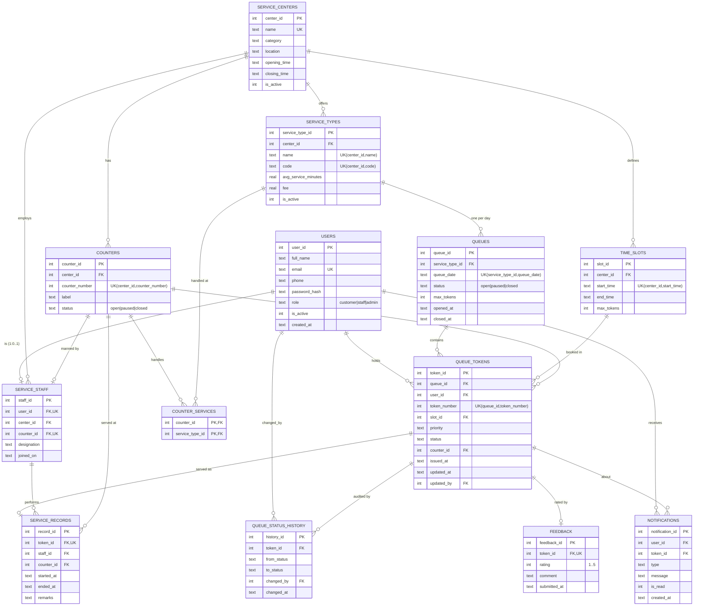

# Database Design — Queue Without Standing

The database is the core of this project. Every business rule that must
always hold is enforced **inside the database** (keys, `CHECK` constraints,
partial unique indexes and triggers), so no client — the web app, a script or
a person at the SQL prompt — can put the data into an invalid state.

| File | Contents |
|------|----------|
| [`db/schema.sql`](../db/schema.sql) | 13 tables, keys, `CHECK` constraints, indexes |
| [`db/triggers.sql`](../db/triggers.sql) | 16 triggers: consistency, state machine, append-only audit trail, notifications |
| [`db/views.sql`](../db/views.sql) | 7 views: live positions, ETAs, timings, center overview |
| [`db/queries.sql`](../db/queries.sql) | 16 report queries (shown live in *Admin › SQL Reports*) |

Engine: **SQLite 3.50** through Node's built-in `node:sqlite` (no server to
install). All SQL is standard apart from SQLite date functions
(`date()`, `datetime()`, `julianday()`, `strftime()`).

---

## 1. Entity–Relationship diagram



### Entities (12 required + 1 associative)

| # | Entity | Purpose |
|---|--------|---------|
| 1 | **User** (`users`) | Every account; `role` distinguishes customer / staff / admin |
| 2 | **ServiceCenter** (`service_centers`) | Canteen, photocopy shop, clinic, office… with opening hours |
| 3 | **Counter** (`counters`) | A physical window in a center with an open/paused/closed status |
| 4 | **ServiceType** (`service_types`) | A service offered by a center; its `code` is the token prefix (`M-014`) |
| 5 | **Queue** (`queues`) | One queue per service type per day |
| 6 | **QueueToken** (`queue_tokens`) | A customer's digital place in a queue |
| 7 | **ServiceStaff** (`service_staff`) | 1:1 specialisation of a staff user, assigned to a center and counter |
| 8 | **ServiceRecord** (`service_records`) | The actual service event of a token: who, where, start/end |
| 9 | **TimeSlot** (`time_slots`) | Recurring daily booking windows with a capacity |
| 10 | **QueueStatusHistory** (`queue_status_history`) | Append-only audit trail of every token status change |
| 11 | **Feedback** (`feedback`) | One 1–5 star rating (+ comment) per completed token |
| 12 | **Notification** (`notifications`) | In-app alerts: token issued, turn near, called, completed… |
| + | `counter_services` | Associative entity resolving Counter **M:N** ServiceType |

### Relationship cardinalities

* ServiceCenter **1:N** ServiceType, Counter, TimeSlot, ServiceStaff
* Counter **M:N** ServiceType (through `counter_services`)
* User **1:0..1** ServiceStaff (specialisation, `user_id UNIQUE`)
* Counter **1:0..1** ServiceStaff (`counter_id UNIQUE` — one person per window)
* ServiceType **1:N** Queue (one per date, `UNIQUE(service_type_id, queue_date)`)
* Queue **1:N** QueueToken; User **1:N** QueueToken
* QueueToken **1:0..1** ServiceRecord, **1:0..1** Feedback (both `token_id UNIQUE`)
* QueueToken **1:N** QueueStatusHistory, Notification

---

## 2. Normalisation

All tables are in **BCNF** (and therefore 3NF, 2NF, 1NF).

* **1NF** – every column is atomic. A counter that serves several services is
  *not* stored as a comma list; the repeating group is moved to
  `counter_services`. Token codes like `M-014` are **not stored** — they are
  derived from `service_types.code` + `token_number` in `v_token_details`.
* **2NF** – the only composite primary key is `counter_services(counter_id,
  service_type_id)`, which has no non-key attributes, so partial dependencies
  are impossible. Every other table has a single-column surrogate key.
* **3NF / BCNF** – no non-key attribute depends on another non-key attribute.
  Design decisions that remove transitive dependencies:

  | Tempting column | Why it is *not* there |
  |-----------------|-----------------------|
  | `queues.center_id` | derivable: `queues → service_types → center_id` |
  | `queue_tokens.service_type_id` / `center_id` | derivable through `queue_id` |
  | `feedback.user_id` | the customer is reached through `token_id → queue_tokens.user_id` |
  | `service_records.center_id` | derivable through `counter_id` |
  | `queue_tokens.called_at`, `completed_at` | live in `queue_status_history` / `service_records` |
  | `queue_tokens.token_code`, `position`, `eta` | computed by views, so they can never be stale |
  | `queues.last_token_number` | computed as `MAX(token_number)+1` inside a write-locked transaction |
  | `service_staff.is_on_duty` | derived from the assigned counter's status (`counter_id IS NOT NULL AND status <> 'closed'`) |

  Every determinant is a candidate key: e.g. in `service_types` both
  `(center_id, name)` and `(center_id, code)` determine the row and both are
  declared `UNIQUE`.

**Deliberate, controlled redundancy** (documented, trigger-guarded):

* `service_staff.center_id` is kept even though it is derivable from
  `counter_id`, because a staff member may exist *without* a counter. Triggers
  `trg_staff_validate_insert/update` guarantee the two never disagree.
* `queue_tokens.updated_by/updated_at` record the actor of the latest change;
  this lets the status trigger write `changed_by` into the audit table.

---

## 3. Integrity constraints

### Keys
* Surrogate `INTEGER PRIMARY KEY` on every entity; composite PK on `counter_services`.
* **Natural keys** as `UNIQUE`: `users.email` (case-insensitive `COLLATE NOCASE`),
  `service_centers.name`, `(center_id, name)` and `(center_id, code)` on services,
  `(center_id, counter_number)`, `(center_id, start_time)` on slots,
  `(service_type_id, queue_date)`, `(queue_id, token_number)`.

### Foreign keys and referential actions
`PRAGMA foreign_keys = ON` for every connection.

| Action | Where | Reason |
|--------|-------|--------|
| `CASCADE` | service types / counters / slots of a deleted center, history / feedback / notifications of a deleted token | dependent data has no meaning alone |
| `RESTRICT` | a service type that has queues, a queue that has tokens, a user who owns tokens, a staff member with service records, a center that still employs staff | history can never be wiped by deleting catalogue rows |
| `SET NULL` | `queue_tokens.slot_id`, `queue_tokens.counter_id`, `service_staff.counter_id`, `changed_by` | the token/person survives, the optional link is cleared |

### `CHECK` constraints (examples)
* enumerations: `role`, `category`, `status` columns, notification `type`
* ranges: `rating BETWEEN 1 AND 5`, `avg_service_minutes > 0 AND <= 240`, `max_tokens > 0`, `fee >= 0`
* formats: `opening_time GLOB '[0-2][0-9]:[0-5][0-9]' AND opening_time < '24:00'`, `date(queue_date) IS queue_date` (rejects 2026-19-39), token code letters only, phone digits only
* cross-column: `closing_time > opening_time`, `end_time > start_time`,
  `ended_at >= started_at`, `(status = 'closed') = (closed_at IS NOT NULL)`
* `CHECK (status NOT IN ('called','serving') OR counter_id IS NOT NULL)` — a called token must be bound to a counter

### Partial unique indexes (business rules as indexes)
```sql
-- a customer holds at most one live token per queue
CREATE UNIQUE INDEX ux_tokens_one_live_per_user
    ON queue_tokens (queue_id, user_id) WHERE status IN ('waiting','called','serving','skipped');
-- a counter calls / serves one token at a time
CREATE UNIQUE INDEX ux_tokens_one_active_per_counter
    ON queue_tokens (counter_id) WHERE status IN ('called','serving');
```

---

## 4. Triggers

| Trigger | Fires | Enforces / does |
|---------|-------|-----------------|
| `trg_counter_services_same_center` | before insert | counter and service type belong to the same center |
| `trg_users_staff_role_locked` | before update of role | a user with a staff profile cannot silently stop being staff |
| `trg_counters_center_immutable`, `trg_service_types_center_immutable` | before update of center | counters and services never move between centers (their links would break) |
| `trg_staff_validate_insert` / `_update` | before insert/update | staff user has role `staff`; counter is in the staff member's center |
| `trg_tokens_validate_insert` | before insert | starts as `waiting`, account active, queue `open`, daily capacity (cancelled tokens excluded), slot belongs to center, **slot capacity** |
| `trg_tokens_immutable_identity` | before update | `queue_id`, `user_id`, `token_number`, `issued_at` never change |
| `trg_tokens_status_transition` | before update of status | the **state machine** below; called only to an *open* counter that *serves that service type* |
| `trg_tokens_validate_links` | before update of counter/slot | a re-pointed counter must serve the service; a re-pointed slot must belong to the center |
| `trg_tokens_after_insert` | after insert | writes the first history row + "token issued" notification |
| `trg_tokens_after_status_change` | after update of status | writes the history row + the matching notification (called / skipped / completed …) |
| `trg_service_records_validate` | before insert | token is `serving`; counter and staff belong to the token's center |
| `trg_feedback_completed_only` | before insert | feedback only for `completed` tokens |
| `trg_history_no_update`, `trg_history_no_delete` | before update/delete | the audit trail is append-only |

Token state machine (anything else is rejected with `RAISE(ABORT)`):

```
waiting ──► called ──► serving ──► completed
   │          │  └──► skipped ──► waiting (re-queued)
   │          │            └────► no_show / cancelled
   │          └──► no_show / cancelled
   └──► cancelled
```

---

## 5. Views

| View | What it computes |
|------|------------------|
| `v_token_details` | token joined with queue, service, center, customer, counter, slot; derives `token_code` |
| `v_waiting_tokens` | live **position** with `ROW_NUMBER() OVER (PARTITION BY queue_id …)`; a slot-booked token becomes eligible when its slot starts |
| `v_service_time_estimates` | real average service time per service over the last 30 days; each duration clamped to 0.25×–4× the configured time and trusted only with ≥ 5 samples (otherwise the configured value) |
| `v_service_live_status` | per service today: waiting, at counter, served, open counters, ETA for a new arrival (`NULL` when no counter is open) |
| `v_token_eta` | estimated wait for each waiting token = `position × avg service time ÷ open counters` (`NULL` when no counter is open) |
| `v_token_timings` | per token: called time (from history), service start/end, **wait and service minutes** |
| `v_center_overview` | one row per center for the public board, incl. 30-day rating |

---

## 6. Transactions

All multi-statement operations run inside `BEGIN IMMEDIATE … COMMIT`
(`src/db.js › transaction()`); any error rolls the whole unit back.
`IMMEDIATE` takes the write lock up front, so two people joining at the same
moment can never get the same token number.

| Operation | Statements in one transaction |
|-----------|-------------------------------|
| **Join queue** | validate service & slot → get-or-create today's queue → `MAX(token_number)+1` → insert token (*triggers*: admission checks, history, notification) → "turn near" alerts |
| **Call next** | check counter open & idle → pick next eligible token across all services of the counter → update to `called` (*trigger*: state machine, history, notification) → alerts |
| **Start serving** | token → `serving` + insert `service_records` row |
| **Complete** | token → `completed` + close the service record |
| **Close queue** | queue → `closed` + cancel every waiting/skipped token (each customer notified by trigger) |
| **Create staff** | insert `users` row + `service_staff` row |
| **Create / edit counter** | counter row + replace its `counter_services` set |

The test suite (`test/queueService.test.js`) verifies that a failed join
leaves no partial rows behind.

Two more rules live in the join transaction: a customer may take at most
15 tokens per day (so nobody can exhaust a queue by joining and cancelling in a
loop), and queues left open from previous days are closed — and their
remaining tokens cancelled — before a new token is issued (also run at server
start and every 10 minutes).

---

## 7. Indexes

Chosen for the hot paths: the live queue (`queue_tokens(queue_id, status,
priority, token_number)`), a user's tokens (`(user_id, issued_at)`), analytics
by time (`issued_at`, `queue_status_history(to_status, changed_at)`), staff
reports (`service_records(staff_id, started_at)`) and unread notifications
(`(user_id, is_read, created_at)`), plus the two partial unique indexes above.
With ~9 000 tokens and ~36 000 history rows every report runs in < 30 ms.

---

## 8. Report queries

`db/queries.sql` contains 16 documented queries, each runnable from
*Admin › SQL Reports*. They cover: multi-table joins, `LEFT JOIN` / anti-joins
(`NOT EXISTS`, `IS NULL`), `GROUP BY … HAVING`, conditional aggregation
(`SUM(CASE …)`), CTEs, window functions (`RANK`, `DENSE_RANK`, `ROW_NUMBER`,
`LAG`), correlated subqueries and queries over views.

| Report | Question answered |
|--------|-------------------|
| `live_queue_board` | How long is every queue right now? |
| `peak_hours`, `busiest_hour_per_center` | When are the rush hours? |
| `wait_time_by_service` | Which service makes people wait longest? |
| `staff_performance` | Who served the most, how fast, how well rated? |
| `center_satisfaction`, `wait_vs_rating` | Are customers happy — and does waiting hurt ratings? |
| `outcome_funnel` | How many tokens end as no-show or cancelled? |
| `daily_trend` | Day-over-day volume (with `LAG`) |
| `time_slot_utilisation` | How full do booking slots get? |
| `frequent_customers`, `inactive_customers` | Who uses the system — and who never did? |
| `counter_load_today` | Which counters are overloaded or idle? |
| `pending_feedback` | Which served tokens were never rated? |
| `status_transition_audit` | Who changed what, when (from the trigger-filled audit table) |
| `notification_engagement` | Are alerts being read? |
